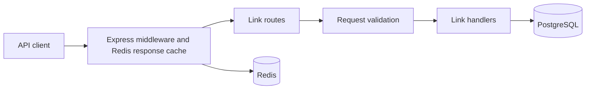

# Application Architecture

## Purpose

This repository is a URL-shortening HTTP API. Express handles requests, PostgreSQL stores links, and Redis caches JSON responses.

## Tech Stack

| Area | Technology | Role |
| --- | --- | --- |
| Runtime | Node.js 22+ | Runs the API as a native ESM application. |
| Language and modules | TypeScript 5+, ES2024 | Strictly typed source compiled to ESM in `dist/`. |
| HTTP | Express 5 | App composition, routing, middleware, and request handling. |
| Persistence | PostgreSQL via `@prisma/orm-postgres` | Stores links using the generated Prisma contract. |
| Cache | Redis | Stores JSON responses for 300 seconds. |
| Validation | `express-validator`, Zod | Validates link requests and runtime environment variables. |
| Build and development | TypeScript, `tsc-alias`, `tsx` | Compiles ESM, resolves emitted imports, and runs watch-mode development. |
| Tests | Jest 30, `ts-jest` | Runs unit and HTTP integration tests. |

## System Overview

## Core Layout

| Path | Responsibility |
| --- | --- |
| `src/app.ts` | Adds cache middleware, mounts link routes, and registers the error handler. |
| `src/index.ts` | Starts the HTTP server using the configured port. |
| `src/config/` | Loads and validates environment variables and configures Express and Redis. |
| `src/routes/` | Declares link endpoints and connects their middleware and controllers. |
| `src/controllers/` | Creates links and redirects requests to saved destinations. |
| `src/middlewares/` | Implements request validation flow, link lookup, caching, handler wrappers, and centralized errors. |
| `src/validators/` | Defines URL and slug validation. |
| `src/prisma/` | Defines the link contract and creates the PostgreSQL ORM client. |
| `src/redis/` | Provides Redis cache read, write, and delete helpers. |
| `src/lib/` | Contains shared utilities such as ID generation. |
| `tests/unit/` | Tests individual handlers and middleware. |
| `tests/integration/` | Tests the composed Express app over HTTP. |

## Database Schema

The generated contract maps the `Link` model to `public."Link"`:

| Column | PostgreSQL type | Nullability | Constraint |
| --- | --- | --- | --- |
| `id` | `integer` | `NOT NULL` | Primary key; supplied by the application, with no database default |
| `url` | `text` | `NOT NULL` | None |
| `slug` | `text` | `NULL` | None |

The contract currently declares no unique indexes or foreign keys. The application derives a Base62 slug from the supplied ID and stores it after creating the row.

## Request Lifecycle

1. `src/config/env.config.ts` selects a dotenv file from the process `NODE_ENV`, then validates `NODE_ENV`, `PORT`, `DATABASE_URL`, and optional `REDIS_URI` with Zod.
2. `src/config/app.config.ts` creates the Express app and registers CORS, Morgan request logging, cookie parsing, JSON parsing, and URL-encoded body parsing.
3. `src/app.ts` applies the Redis cache middleware before mounting the link router, then registers the centralized error handler.
4. `POST /` validates the submitted URL, reuses a slug if the URL already exists, or persists a new link and returns its Base62 slug.
5. `GET /:slug` validates and looks up the slug, returns 404 when it is unknown, or redirects to an HTTPS destination assembled from the stored URL.
6. The cache middleware keys responses by method, path, query, and body and stores JSON responses in Redis for 300 seconds. Redis connects during module initialization.

## Configuration and Build

- `DATABASE_URL` is required and supplies the PostgreSQL ORM client. `REDIS_URI` is optional in the environment schema; ensure Redis is reachable because the client connects during startup.
- `PORT` defaults to `3000`. `NODE_ENV` defaults to `development` and accepts `development`, `production`, or `test`.
- The environment loader selects `.env.dev`, `.env.development`, or `.env.local` for development; `.env.prod` or `.env.production` for production; and `.env.test` for tests. Each list falls back to `.env`. Selection uses the process value before dotenv loads; if it is unset or unrecognized, only `.env` is checked.
- `package.json` declares `"type": "module"`. `npm run build` runs `tsc` followed by `tsc-alias --resolve-full-paths`, which rewrites aliases and adds `.js` extensions to resolvable extensionless imports in emitted files, then copies the homepage HTML beside the compiled controller. This makes the output compatible with native Node.js ESM resolution and keeps the homepage available in the build.
- `npm run dev` runs `tsx watch src/index.ts`. `npm start` builds the app and starts `dist/src/index.js` with `NODE_ENV=production`.

## Tests and Delivery

- Jest runs TypeScript tests in the Node environment using the ESM `ts-jest` preset.
- Run `npm run typecheck`, `npm test -- --runInBand`, and `npm run build` to validate changes.
